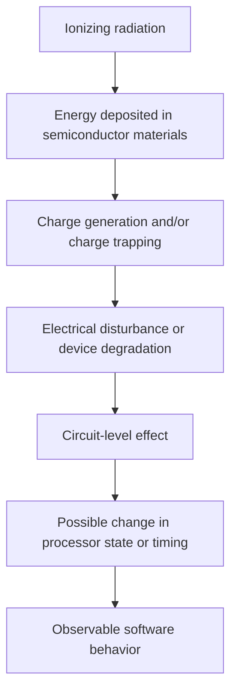

*Exploring how ionizing radiation affects semiconductor devices, software execution, and the security of embedded systems.*

## 1. Introduction

Microcontrollers are at the heart of embedded systems, from industrial controllers and IoT devices to automotive electronics, aerospace systems, and secure hardware. Their software is expected to execute predictably, but the physical environment in which a processor operates can influence its behavior.

Ionizing radiation is one such environmental factor. When radiation interacts with semiconductor materials, it can alter electrical characteristics or generate transient disturbances that affect circuit operation. These effects are traditionally studied in the context of semiconductor reliability and radiation-hardening, particularly for systems operating in space or other radiation environments.

However, radiation effects also raise an important security question:

> Can physical disturbances caused by ionizing radiation affect the execution of software in ways that violate the assumptions made by security-critical systems?

Understanding this question requires connecting semiconductor physics, computer architecture, embedded software, fault injection, and experimental measurement.

## 2. Understanding Total Ionizing Dose (TID)

Total Ionizing Dose (TID) describes the cumulative ionizing energy absorbed by a material over time. It is commonly expressed in units such as rad(Si) or gray (Gy), where 1 Gy corresponds to one joule of absorbed energy per kilogram.

In MOS-based technologies, ionizing radiation can generate electron-hole pairs in insulating materials. Some of the generated charge may become trapped in gate oxides or at interfaces. Depending on the device technology and exposure conditions, these effects can modify transistor characteristics.

Potential consequences include:

- Threshold-voltage shifts
- Increased leakage current
- Changes in switching characteristics
- Reduced timing margins
- Increased power consumption
- Degradation of circuit reliability

TID is an accumulated effect: its impact depends on factors such as radiation type, total dose, dose rate, device technology, bias conditions, temperature, and circuit design.

It is important to distinguish TID from single-event effects. TID describes cumulative radiation-induced changes, whereas single-event effects (SEEs) result from an individual particle or radiation interaction depositing charge in a sensitive region. Depending on the mechanism, an SEE may cause a transient pulse, a bit upset, a latch-up event, or another circuit-level disturbance.

These phenomena can interact in a broader radiation environment, but they are not interchangeable. An experiment must define which effect it is designed to investigate.

## 3. From Semiconductor Physics to Software Faults

A microcontroller executes instructions through a chain of hardware components: registers, combinational logic, sequential circuits, memory, clocking, and control logic.

Software execution depends on the correct operation of these components. If a physical disturbance affects the state of a circuit, the disturbance may propagate through the system and potentially influence program execution.

A fault may manifest as:

- An incorrect intermediate computation
- A corrupted register or memory value
- An unexpected control-flow transition
- An incorrect output
- A failed operation
- A system reset or malfunction

The relationship between radiation and software behavior is not always straightforward. A physical disturbance does not necessarily produce a visible software error. It may be masked by the architecture, corrected by internal mechanisms, overwritten before observation, or propagated into a system-level failure.

This makes experimental characterization essential.

### A simplified physical-to-software chain

This is a conceptual chain, not a guarantee that every radiation interaction produces a software-visible fault. Device design, circuit architecture, operating conditions, and error-masking mechanisms all influence the outcome.

## 4. Fault Injection and Hardware Security

Fault injection is a research technique used to evaluate how systems behave under abnormal operating conditions. Rather than assuming a system is reliable because it works correctly under normal conditions, researchers introduce or study disturbances and investigate whether the system detects, tolerates, or recovers from them.

Fault injection is relevant to hardware security because security mechanisms also rely on correct execution.

Embedded systems may implement:

- Secure boot
- Authentication
- Cryptographic operations
- Firmware integrity checks
- Access-control decisions
- Safety checks

A fault that affects the execution of a security-critical operation could potentially weaken a security guarantee.

Fault-injection research therefore examines not only whether a fault occurs, but also how it propagates, whether it is observable, and whether existing defenses are effective.

A useful distinction is between a **fault**, an **error**, and a **failure**:

- A *fault* is the underlying cause or abnormal condition.
- An *error* is an incorrect internal state resulting from a fault.
- A *failure* occurs when the system's delivered behavior deviates from its required service.

A fault may never become an observable failure if it is masked, detected, or corrected.

## 5. Side-Channel Attacks and Fault Attacks: Different Threats

Hardware security research often investigates both side-channel attacks and fault attacks.

### Side-channel attacks

Side-channel analysis studies unintended information leaked through physical behavior during computation. Examples include:

- Power consumption
- Electromagnetic emissions
- Execution timing
- Acoustic or other measurable signals

The objective is to understand whether these signals reveal information about internal operations or secret data.

### Fault attacks

Fault attacks study how abnormal physical conditions can alter computation. The objective is to understand whether faults can affect system behavior in a way that undermines security or reliability.

The two research areas are related because both examine the physical implementation of digital systems rather than only their intended software behavior. However, they address different security properties: side channels concern information leakage, while fault attacks concern computational integrity.

Radiation-related experiments may therefore investigate both functional behavior and measurable physical signals, depending on the research question and instrumentation.

## 6. The Experimental Workflow

Characterizing radiation-related effects on software running on a microcontroller requires a structured experimental methodology.

### Step 1 — Literature review and threat model

The first step is to understand the state of the art in radiation effects, fault injection, hardware security, and relevant side-channel research.

The literature review establishes:

- Known radiation-induced effects
- Relevant device technologies
- Potential fault models
- Security-sensitive software behaviors
- Existing countermeasures
- Limitations of previous experiments

A threat model defines what is being evaluated, the assumptions made about the target, and the expected impact of disturbances.

It is also important to identify the radiation mechanism under study. A cumulative TID campaign and a campaign focused on transient single-event effects require different experimental designs and interpretations.

### Step 2 — Experimental platform configuration

The experimental platform must provide a repeatable environment for executing software, interacting with the target, collecting measurements, and recording results.

[ChipWhisperer](https://chipwhisperer.readthedocs.io/en/latest/) is an open-source hardware-security platform used for side-channel analysis and fault-injection research. Its ecosystem combines capture hardware, target devices, firmware, and software interfaces that support repeatable measurements and analysis.

Depending on the configuration, the target may be a microcontroller or an FPGA-based implementation.

The platform is not itself an X-ray source. Radiation exposure is a separate experimental capability that requires appropriate equipment, facilities, safety controls, and instrumentation. ChipWhisperer can form part of the measurement and control setup, but it should not be described as providing radiation exposure.

### Step 3 — Target software and baseline characterization

A controlled software workload is required to establish how the target behaves under nominal conditions.

The workload should be sufficiently simple and reproducible that its expected execution behavior can be characterized. A baseline provides the reference against which observations under altered physical conditions can be compared.

Depending on the experiment, researchers may consider:

- Execution correctness
- Output consistency
- Timing behavior
- Error conditions
- System resets
- Functional integrity

The goal is to distinguish normal variability from meaningful deviations.

It is useful to keep the target workload, compiler settings, firmware version, clock configuration, supply conditions, and measurement configuration under version control. This helps make comparisons reproducible.

### Step 4 — Experimental campaign

The experiment involves applying the defined environmental conditions, executing the target workload, observing the system, and recording measurements.

Scientific rigor requires repeatability, controlled conditions, documented parameters, and appropriate reference measurements.

A single anomalous observation is not necessarily evidence of a radiation-induced effect. Repeated observations and statistical analysis are needed to assess whether the results are significant and reproducible.

For a TID study, the accumulated dose and exposure conditions must be documented. Depending on the research question, measurements may be taken before, during, and after exposure to identify changes over time.

### Step 5 — Data analysis and evaluation

Collected measurements must be analyzed to identify patterns, quantify deviations, and evaluate their impact.

Depending on the study, analysis may include:

- Comparing baseline and experimental behavior
- Categorizing observed failures
- Quantifying error rates
- Evaluating repeatability
- Investigating the relationship between experimental conditions and observed outcomes
- Assessing uncertainty and limitations

The interpretation must remain grounded in the data. Correlation between an experimental condition and a failure does not automatically establish the underlying mechanism.

Useful experimental records may include dose, dose rate, exposure duration, device temperature, supply voltage, clock frequency, workload version, firmware build, reset count, output correctness, timing measurements, and instrument configuration.

### Step 6 — Countermeasures and validation

Once potential weaknesses are identified, researchers can investigate countermeasures.

Depending on the threat and system, possible approaches include:

- Redundant computation
- Consistency checks
- Error-detection mechanisms
- Control-flow integrity checks
- Watchdogs
- Fault-aware software design
- Hardware-supported resilience

Countermeasures introduce their own trade-offs, including execution overhead, additional memory requirements, power consumption, latency, and complexity.

A proposed defense must therefore be evaluated rather than assumed to be effective. Its effectiveness, limitations, and cost should be compared against the original implementation.

## 7. ASICs, FPGAs, and the Importance of the Target

Experiments may use an ASIC or a softcore processor implemented on an FPGA.

An **ASIC (Application-Specific Integrated Circuit)** is a dedicated integrated circuit whose architecture and implementation are determined by its hardware design. An **FPGA (Field-Programmable Gate Array)** is a reconfigurable device that can implement digital circuits, including processor cores.

Both can be used to study software execution, but they are not physically equivalent.

Differences in transistor technology, architecture, implementation, memory, clocking, and physical layout may influence their behavior under radiation. Therefore, findings from one implementation should not automatically be generalized to another.

A softcore FPGA processor can provide a flexible experimental platform, while an ASIC may offer a more representative target for studying effects on a particular silicon implementation.

## 8. Why Countermeasures Matter

Reliability and security cannot be evaluated solely by whether software works under nominal conditions.

A robust system should be designed to detect abnormal execution, limit the propagation of errors, and recover safely when possible.

Countermeasures should be evaluated along multiple dimensions:

<table>
    <thead>
    <tr>
        <th>Metric</th>
        <th>Research question</th>
    </tr>
    </thead>
    <tbody>
    <tr>
        <td>Functional correctness</td>
        <td>Does the program produce the expected result?</td>
    </tr>
    <tr>
        <td>Fault detection</td>
        <td>Can abnormal behavior be detected?</td>
    </tr>
    <tr>
        <td>Resilience</td>
        <td>Does the system remain operational when faults occur?</td>
    </tr>
    <tr>
        <td>Performance overhead</td>
        <td>How much additional execution time does the countermeasure introduce?</td>
    </tr>
    <tr>
        <td>Memory overhead</td>
        <td>How much additional memory or storage is required?</td>
    </tr>
    <tr>
        <td>Power consumption</td>
        <td>Does the countermeasure increase energy consumption?</td>
    </tr>
    <tr>
        <td>Security effectiveness</td>
        <td>Does the countermeasure effectively mitigate the defined threat?</td>
    </tr>
    </tbody>
</table>

This is a multi-objective engineering problem. Stronger protection may require more resources, and practical embedded systems must balance resilience against hardware and software constraints.

## 9. From Reliability Research to Security Research

Radiation effects have historically been important in aerospace and other harsh environments, where electronic systems must remain operational despite exposure to ionizing radiation.

The same physical phenomena can also be investigated from a security perspective. Instead of asking only how radiation affects device lifetime, researchers may ask whether radiation-induced disturbances influence security-critical execution and whether the system's defenses are sufficient.

This perspective creates an intersection between:

- Semiconductor reliability
- Embedded systems
- Hardware security
- Fault-tolerant computing
- Cryptographic implementation security
- Physical attack research

Understanding these connections is essential for developing secure and resilient embedded platforms.

## 10. Learning and Research Directions

This topic requires knowledge across several disciplines. A useful learning path includes:

1. **Semiconductor fundamentals:** MOSFETs, CMOS, charge carriers, and device characteristics.
2. **Digital architecture:** Registers, memory, logic, processor pipelines, and instruction execution.
3. **Embedded systems:** Microcontrollers, firmware, C, debugging, and hardware/software interfaces.
4. **Hardware security:** Fault models, side-channel analysis, countermeasures, and security evaluation.
5. **Radiation effects:** TID, transient effects, charge generation, device degradation, and reliability.
6. **Experimental research:** Measurement methodology, data analysis, statistical evaluation, and reproducibility.

The challenge is not simply to understand the physics or to run a piece of software. It is to connect physical effects to observable system behavior and determine what those observations mean for reliability and security.